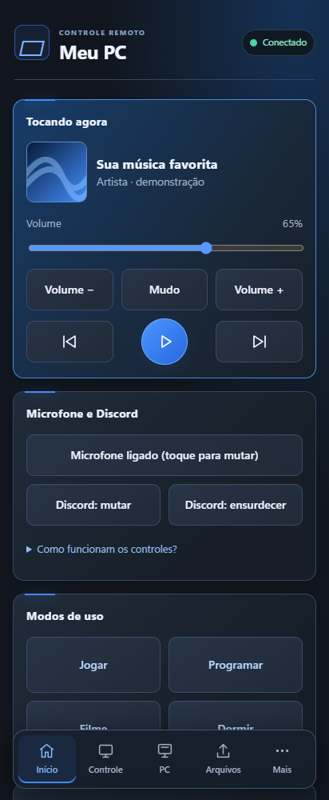
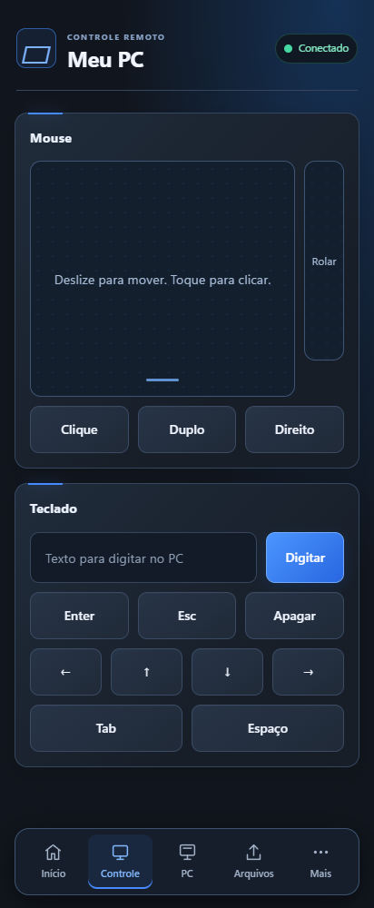
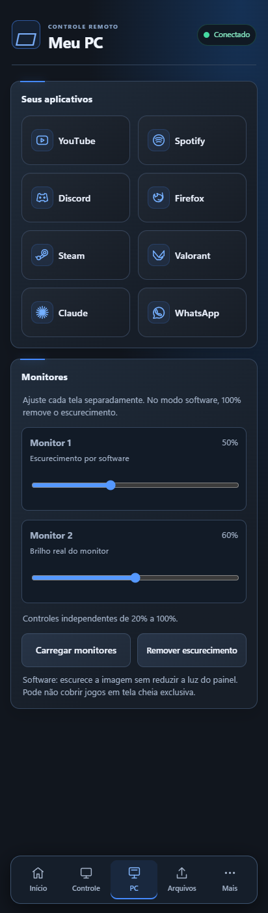
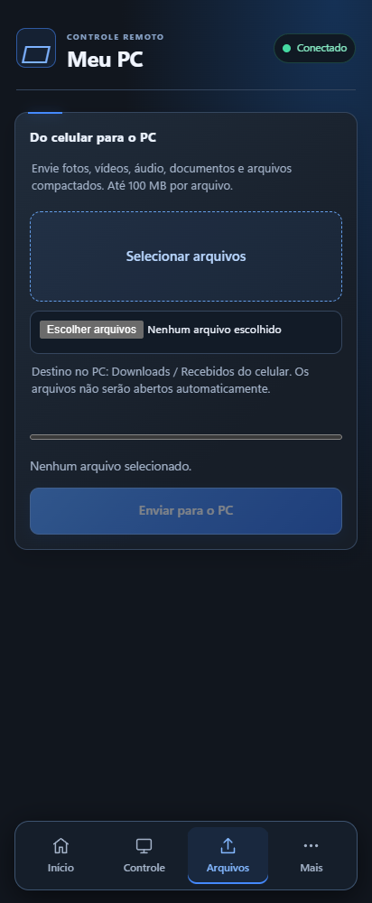
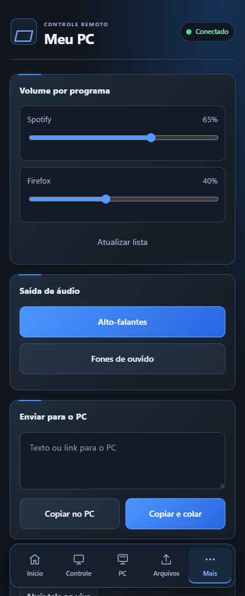
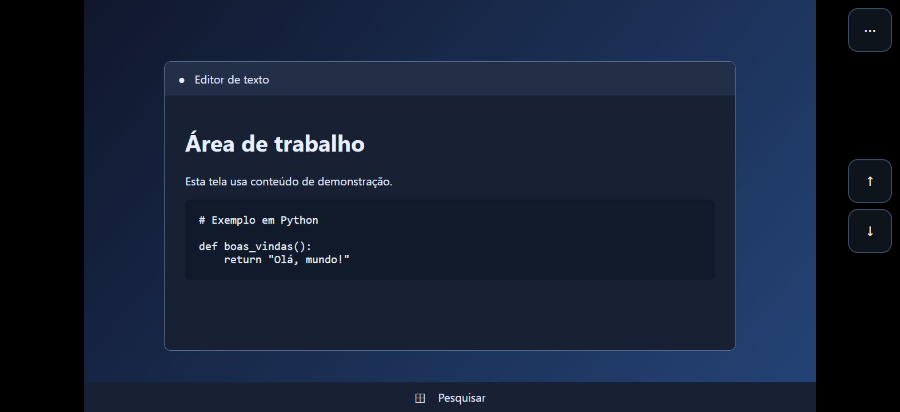

# Controle do PC pelo celular

Controle seu computador com Windows pelo celular na mesma rede Wi-Fi. Um servidor Python com FastAPI e Flask executa as ações no PC, uma interface web reúne os controles e um app Android com WebView permite acessar tudo em tela cheia.

O projeto tem interface em **grafite e azul**, com cinco abas: **Início**, **Controle**, **PC**, **Arquivos** e **Mais**. Não precisa de app Android para usar: o navegador do celular também funciona.

Projeto pessoal de aprendizado e portfólio, desenvolvido com auxílio de Claude e Codex como ferramentas de estudo.

## Interface

As imagens abaixo são capturas da interface atual renderizada em tamanho de celular. Os dados de música, volume e uso do computador são fictícios para demonstração; não são capturas de uma sessão conectada a um PC.

<p align="center">
  
  
</p>
<p align="center">
  
  
  
</p>

## O que dá para fazer

| Aba | Recursos |
| --- | --- |
| **Início** | Música com capa, reprodução e volume; microfone do Windows; atalhos globais do Discord; modos; bloquear, suspender, desligar e reiniciar; agendar e cancelar desligamento. |
| **Controle** | Touchpad com cliques e rolagem; digitar texto no PC; Enter, Esc, apagar, setas, Tab e Espaço. |
| **PC** | Atalhos de aplicativos e controles independentes de brilho real ou escurecimento por software. |
| **Arquivos** | Enviar fotos, vídeos, áudio, documentos e arquivos compactados ao PC, com seleção múltipla e progresso por arquivo. |
| **Mais** | Volume por programa, saída de áudio, copiar/colar texto no PC, transmissão ao vivo e uso de CPU, memória e disco. |

A aba **PC** reúne os controles dos monitores e os atalhos de aplicativos, reduzindo a rolagem em **Mais**.

Os atalhos atuais incluem YouTube, Spotify, Discord, Firefox, Steam, Valorant, Claude e WhatsApp. PyCharm continua no modo **Programar**, sem um botão separado na lista de aplicativos.

## Como funciona

```text
Celular (navegador ou app Android)
              |
         Wi-Fi local
       POST e WebSocket autenticados
              |
Servidor FastAPI e Flask no Windows — porta 5000
              |
   Ações no PC / arquivos recebidos
```

O app Android abre a interface servida pelo próprio PC. As mudanças no HTML aparecem após recarregar a página; recursos nativos, como o seletor de arquivos, precisam de um APK atualizado.

## Transmissão ao vivo

Em **Mais → Tela do PC**, toque em **Abrir tela ao vivo**. A transmissão abre em tela cheia com o monitor inteiro visível. Use as setas à direita para rolar ou escolha **⋯ → Preencher tela** para ocupar a área disponível com a imagem, com possível corte nas bordas.

Deslize para mover o cursor e toque para clicar onde ele estiver. No menu **⋯**, você pode alternar para toque direto, armar o clique direito ou abrir o teclado. O teclado pode aparecer automaticamente quando o Windows detecta um cursor de texto. O modo imersivo que oculta as barras do Android exige o APK atualizado.

A captura usa o monitor principal, com até 1920 pixels no lado maior e até 20 quadros por segundo. O envio de quadros e o recebimento dos comandos do cursor rodam em paralelo.

<p align="center">
  
</p>

## Requisitos

- Windows 10 ou 11.
- Python 3.10 ou superior, disponível no PATH.
- Celular e PC na mesma rede Wi-Fi.
- Para gerar o app: Android Studio, SDK 34 e um JDK compatível com Gradle 8.7; o projeto foi compilado com JDK 21 e código Java 17.

Dependências do servidor: Flask, pynput, psutil, Pillow, pyperclip e `pycaw==20240210`. Para a transmissão, o servidor também usa FastAPI, Uvicorn, WebSockets, a2wsgi e MSS. A versão do pycaw é fixa porque a API de áudio muda nas versões mais recentes.

## Rodar no PC

1. Baixe ou clone o repositório.
2. Entre na pasta `servidor` e abra `iniciar.bat`. Ele instala as dependências e inicia o servidor.
3. Deixe a janela aberta. Ela mostra o endereço para abrir no celular e a credencial de acesso.
4. No celular, abra esse endereço no navegador ou configure-o no app Android.
5. Digite a credencial quando a interface pedir. Se o Firewall perguntar, permita o Python em **redes privadas**.

Também é possível iniciar pelo terminal:

```powershell
cd servidor
python -m pip install -r requirements.txt
python app.py
```

A credencial vem da variável de ambiente `PC_TOKEN` ou de `servidor/token.txt`, gerado na primeira execução e ignorado pelo Git. Não compartilhe esse arquivo nem prints que mostrem seu conteúdo.

### Iniciar com o Windows

| Arquivo em `servidor/` | Função |
| --- | --- |
| `iniciar.bat` | Instala dependências e roda com janela para diagnóstico. |
| `iniciar_oculto.vbs` | Inicia sem janela. |
| `instalar_inicio.bat` | Cria o atalho de inicialização com o Windows. |
| `parar.bat` | Encerra o processo que escuta a porta 5000. |
| `remover_inicio.bat` | Remove o atalho de inicialização. |

O servidor impede novas cópias simultâneas na mesma sessão do Windows. Para carregar mudanças no Python, execute `parar.bat` e só então `iniciar.bat`; abrir o iniciador novamente não atualiza uma instância que já está rodando.

Execute `iniciar.bat` pelo menos uma vez antes de configurar o início automático. Depois de reiniciar o computador, o app só conecta se o servidor também estiver rodando.

## Enviar arquivos do celular

1. Abra a aba **Arquivos**.
2. Selecione um ou mais arquivos e toque em **Enviar para o PC**.
3. Acompanhe o progresso. Os envios são feitos um de cada vez.
4. No PC, abra **Downloads → Recebidos do celular**, na pasta do usuário que executa o servidor.

- Limite: **100 MB por arquivo**.
- Fotos: JPG/JPEG, PNG, GIF, WebP, HEIC/HEIF, AVIF e BMP.
- Vídeos: MP4, MOV, MKV, WebM, AVI e 3GP.
- Áudio: MP3, M4A, WAV, OGG, FLAC, AAC e OPUS.
- Documentos: PDF, TXT, CSV, DOC/DOCX, XLS/XLSX, PPT/PPTX, ODT/ODS/ODP e EPUB.
- Compactados: ZIP, RAR e 7Z.

O servidor valida a extensão, normaliza o nome e acrescenta um identificador para evitar sobrescritas. Os arquivos são somente salvos: não são abertos, executados nem descompactados. A extensão permitida não garante que o conteúdo seja seguro; envie arquivos de origem conhecida.

Se a conexão cair, confira a pasta no PC e selecione apenas os arquivos restantes antes de tentar novamente. O app não retoma envios interrompidos automaticamente.

**No Android:** é necessário instalar o APK com suporte ao seletor de arquivos. A versão anterior do WebView pode mostrar o botão sem conseguir abrir o seletor. Pelo navegador do celular, não é necessário instalar APK.

## Modos e aplicativos

Os atalhos ficam em `servidor/atalhos.json`:

```json
[
  {"nome": "YouTube", "alvo": "https://www.youtube.com"},
  {"nome": "WhatsApp", "alvo": "app:WhatsApp"}
]
```

`app:Nome` procura o programa no Menu Iniciar; o aplicativo precisa estar instalado e o nome precisa corresponder ao seu atalho. URLs abrem no navegador padrão.

Os modos ficam em `servidor/modos.json`:

| Modo | Comportamento atual |
| --- | --- |
| **Jogar** | Abre Riot Client e Discord. |
| **Programar** | Abre Firefox, PyCharm e Claude. |
| **Filme** | Abre Stremio, mantém o volume e solicita o fechamento normal das janelas visíveis do Firefox, Spotify, ChatGPT e Claude, sem confirmação adicional, e ajusta o Samsung deste setup para 50% por software. |
| **Dormir** | Ajusta o volume para 15% e agenda o desligamento em 30 minutos. |

O preset de brilho do modo Filme é específico do setup de desenvolvimento: ajusta somente o Samsung identificado, sem mudar o Haiz ou o volume. Se não encontrar uma única tela correspondente, mantém os monitores e avisa na resposta.

O modo Filme usa uma ação própria no servidor (`"acao": "cinema"`). O servidor tenta primeiro instalações conhecidas do Stremio e depois o Menu Iniciar. Se não conseguir iniciá-lo, não solicita o fechamento das janelas. Ele não encerra outros programas, como Rainmeter e utilitários de otimização. Firefox, Spotify, ChatGPT e Claude são fechados normalmente, sem matar processos à força; avisos de trabalho não salvo podem exigir interação no PC.

## Brilho dos monitores

Em **PC → Monitores**, toque em **Carregar monitores**. A consulta só ocorre quando solicitada, sem atrasar a abertura da interface. Cada tela tem seu próprio controle entre 20% e 100%; o comando é enviado ao soltar o slider.

- **Brilho real:** usa DDC/CI, quando disponível, com confirmação por leitura do valor. Depende do monitor, driver, cabo e adaptadores.
- **Escurecimento por software:** cria uma camada preta sem capturar cliques ou foco. Em 100%, a camada é removida; não reduz a iluminação física do painel.
- **Remover escurecimento:** remove todas as camadas por software, mantendo o brilho físico dos monitores.

A camada é removida ao encerrar o servidor e pode não cobrir jogos em tela cheia exclusiva. Após desconectar ou reorganizar telas, remova o escurecimento e atualize a lista antes de ajustar novamente.

No setup usado para desenvolvimento, o Haiz HZ-LM25GM respondeu ao controle DDC/CI. O Samsung conectado por conversor VGA usa escurecimento por software. Os nomes desses dois dispositivos são associados a códigos conhecidos no módulo; outras telas usam a identificação do Windows, que pode ser genérica. O funcionamento ainda depende da compatibilidade de cada computador.

Os módulos `servidor/monitores.py` e `servidor/escurecer.py` usam bibliotecas do Windows e Tkinter, incluído na instalação padrão do Python para Windows; não foram adicionados pacotes ao requirements.txt. Ao atualizar o servidor, copie esses módulos junto do app.py e index.html.

## Recursos opcionais

Sem estas instalações, os demais controles continuam funcionando.

**Música e capa (Tocando agora):**

```powershell
python -m pip install winrt-runtime winrt-Windows.Media.Control winrt-Windows.Storage.Streams winrt-Windows.Foundation winrt-Windows.Foundation.Collections
```

**Troca da saída de áudio:** no **Windows PowerShell 5.1**, instale:

```powershell
Install-Module -Name AudioDeviceCmdlets -Scope CurrentUser
```

O servidor usa `powershell.exe`; instalar somente no PowerShell 7 não disponibiliza o módulo nesse ambiente.

**Discord:** em Configurações → Atalhos, configure:

- Alternar mudo: `Ctrl+Shift+Alt+M`.
- Alternar surdo: `Ctrl+Shift+Alt+D`.

Esses botões enviam atalhos e não leem o estado do Discord. O botão de microfone controla o dispositivo padrão do Windows. Jogos com anti-cheat podem bloquear teclas simuladas.

## Gerar o APK

1. Abra a pasta `android/` no Android Studio, a que contém `settings.gradle`.
2. Aguarde a sincronização. O projeto usa Gradle 8.7, Android Gradle Plugin 8.5.2, SDK 34 e Android 7.0 ou superior (minSdk 24).
3. Use **Build → Generate App Bundles or APKs → Generate APKs**.
4. O resultado fica em `android/app/build/outputs/apk/debug/app-debug.apk`.
5. Transfira para o celular e instale. Para atualizar sem desinstalar, use a mesma assinatura da instalação anterior.

O endereço é solicitado na primeira abertura e fica salvo no celular. O código usa um marcador genérico em `ENDERECO_PADRAO`; substitua-o na tela pelo endereço mostrado pelo servidor. O seletor Android permite escolher vários documentos sem pedir acesso amplo ao armazenamento.

APKs e pastas de build não entram no código-fonte. Binários distribuídos podem ser anexados à área de [Releases](https://github.com/Fournier7/controle-pc-celular/releases).

## Segurança e limites

- As ações HTTP usam POST com proteção de rede local e autenticação por `X-Token`. A transmissão usa WebSocket com um bilhete de sessão de uso único, emitido por uma rota POST autenticada.
- Cinco credenciais erradas bloqueiam o aparelho por um minuto.
- Teclas, ações e programas a fechar são validados por listas no servidor.
- O upload usa uma pasta fixa, extensões permitidas e limite de tamanho; o celular não escolhe um caminho no PC.
- O tráfego usa HTTP, sem criptografia: use somente uma rede confiável. Quem tiver a credencial e acesso à rede pode controlar o PC.
- O servidor escuta em `0.0.0.0:5000`. **Nunca exponha a porta 5000 na internet.** O código aceita a faixa do Tailscale, mas a configuração de acesso externo ainda precisa ser testada.
- A captura de tela mostra o monitor principal. O Windows bloqueado pode impedir uma captura útil.
- Wake-on-LAN em `servidor/ligar.py` continua experimental e precisa de outro aparelho ligado na rede para enviar o pacote.

## Estrutura

```text
controle-pc-celular/
  README.md
  CHANGELOG.md
  AGENTS.md
  servidor/        FastAPI, Flask, interface, configurações e scripts do Windows
  android/         Aplicativo WebView e seletor de arquivos
  docs/
    imagens/       Capturas da interface com dados de demonstração
  tests/           Testes isolados do recebimento de arquivos
```

## Verificação e atualização

Com as dependências instaladas, na raiz do projeto:

```powershell
python -m py_compile servidor/app.py
python tests/testar_envio.py
python tests/testar_cache_apps.py
python tests/testar_filme.py
python tests/testar_instancia.py
python tests/testar_monitores.py
python tests/testar_filme_samsung.py
```

Os testes de upload extraem as rotas do código sem iniciar o controle do PC nem ler a credencial local. Verificam autenticação, método HTTP, formatos, nomes, duplicatas, limite e remoção de arquivos parciais. Não substituem os testes de áudio, mouse e envio real pelo celular.

| Alteração | O que fazer para carregar |
| --- | --- |
| `servidor/app.py` ou `servidor/desktop.py` | Reiniciar o servidor. |
| `index.html`, `atalhos.json` ou `modos.json` | Recarregar a página ou reabrir o app. |
| Código em `android/` | Gerar e instalar um APK novo. |

Se o app não conectar, execute `iniciar.bat` para ver possíveis erros, confira o Wi-Fi e compare o endereço salvo com o mostrado pelo servidor. O endereço do PC pode mudar após reiniciar.

Veja o [histórico de mudanças](CHANGELOG.md). O guia em PDF de `docs/`, quando presente, pode descrever uma versão anterior; este README documenta a interface atual.
